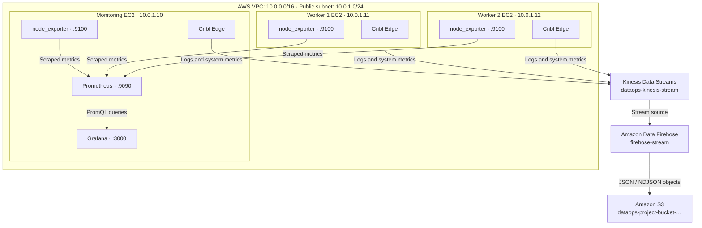
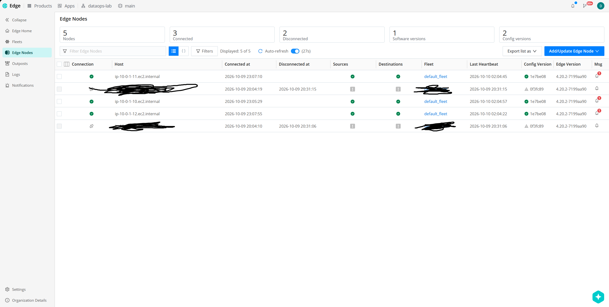
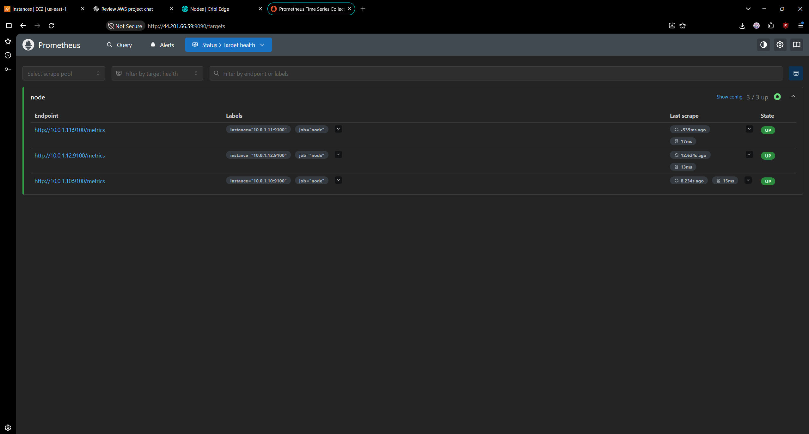
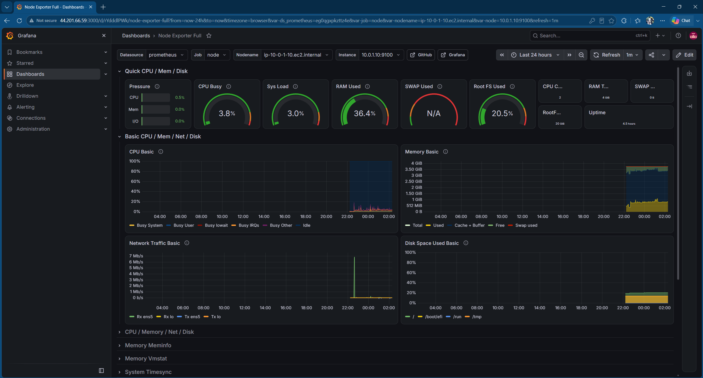
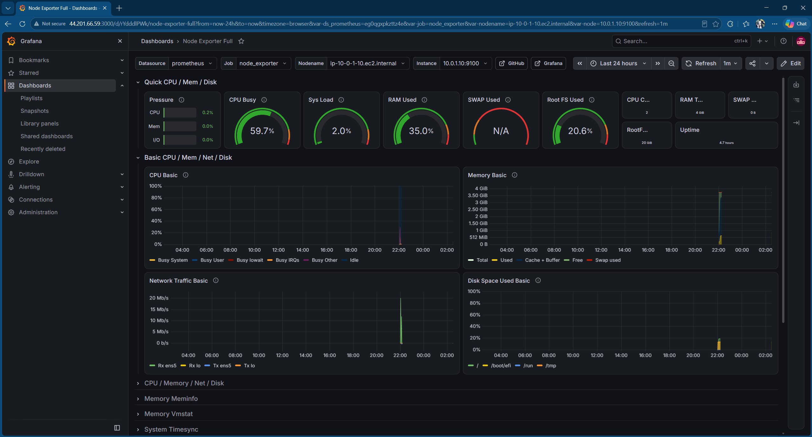
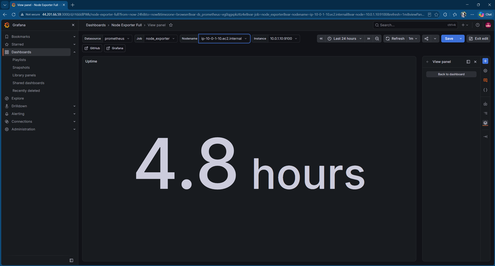
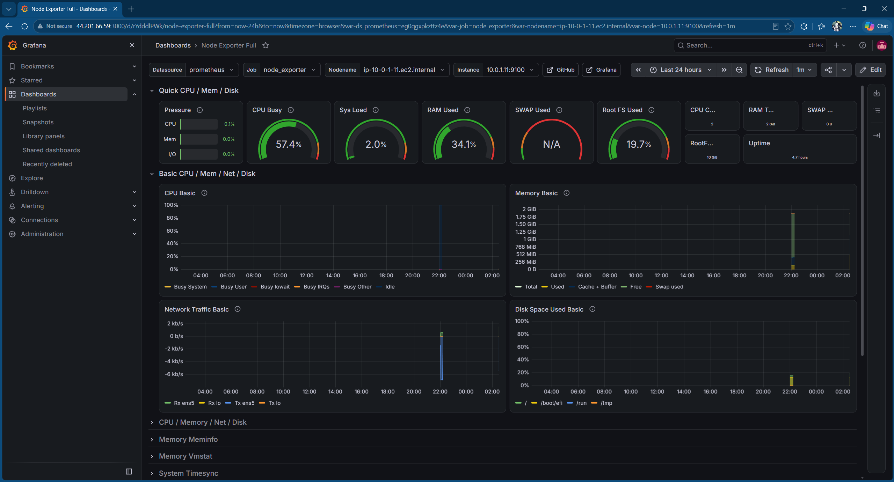
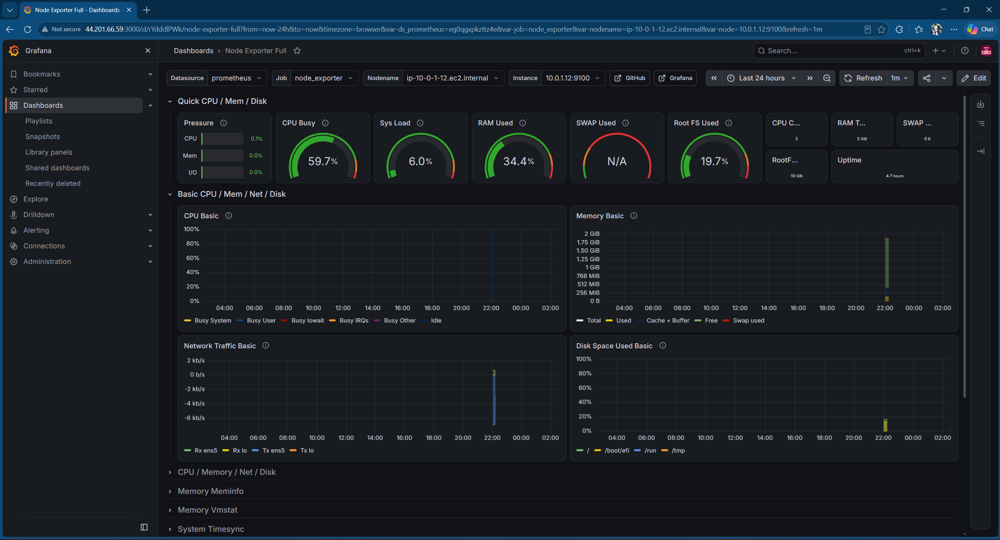
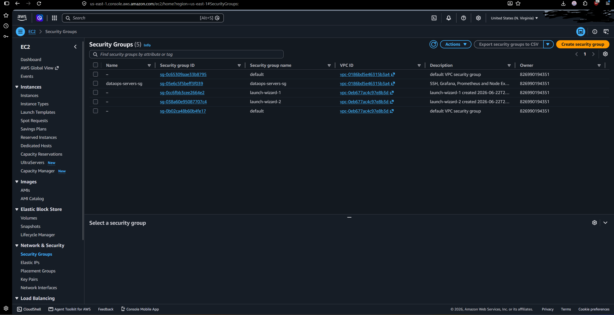

# DataOps Observability & Data Pipeline

An AWS-based observability lab that collects Linux host logs and system metrics with Cribl Edge, streams events through Amazon Kinesis Data Streams and Amazon Data Firehose, and stores the resulting JSON events in Amazon S3. Prometheus scrapes `node_exporter` on three EC2 instances, and Grafana visualizes the metrics.

> **Project status:** Core paths were tested end to end. The verification results and implementation limitations are documented below. This is a learning project, not a hardened production deployment.

## Contents

- [Architecture](#architecture)
- [AWS infrastructure](#aws-infrastructure)
- [Data flows](#data-flows)
- [Security](#security)
- [Validation results](#validation-results)
- [Screenshots](#screenshots)
- [Configuration notes](#configuration-notes)
- [Reproducibility and cost notes](#reproducibility-and-cost-notes)

## Architecture



The architecture has two separate paths:

1. **Metrics dashboard:** `node_exporter` → Prometheus → Grafana.
2. **Logs and events storage:** Cribl Edge → Kinesis Data Streams → Amazon Data Firehose → S3.

Grafana queries Prometheus. Prometheus scrapes the three `node_exporter` endpoints.

## AWS infrastructure

### Network and compute

| Component | Configuration |
|---|---|
| AWS Region | `us-east-1` (US East, N. Virginia) |
| VPC | `10.0.0.0/16` |
| Public subnet | `10.0.1.0/24` |
| Monitoring server | Amazon Linux 2023 EC2, private IP `10.0.1.10` |
| Worker 1 | Amazon Linux 2023 EC2, private IP `10.0.1.11` |
| Worker 2 | Amazon Linux 2023 EC2, private IP `10.0.1.12` |
| All three instances | Cribl Edge and `node_exporter` |
| Monitoring server only | Prometheus and Grafana |

Public IPv4 addresses are intentionally not documented here because they can change when instances are recreated.

### Logs and metrics pipeline

| Component | Name / configuration |
|---|---|
| Kinesis Data Stream | `dataops-kinesis-stream` |
| Kinesis mode | Provisioned, one shard; 24-hour retention |
| Kinesis encryption | AWS-managed KMS key (`alias/aws/kinesis`) |
| Firehose delivery stream | `firehose-stream` |
| Firehose source | `dataops-kinesis-stream` |
| Firehose destination | Project S3 bucket with prefix `logs/year=…/month=…/day=…/hour=…/` |
| Firehose buffering | 1 MB or 60 seconds |
| Firehose format conversion | Disabled; no Parquet conversion configured |
| S3 event representation | JSON / newline-delimited JSON (NDJSON) |
| S3 default encryption | SSE-S3 (`AES256`) |

The S3 bucket name is generated with the prefix `dataops-project-bucket-` and a unique suffix. Replace the abbreviated name in descriptions with the actual bucket name when operating the project.

## Data flows

### Prometheus and Grafana

Prometheus uses the scrape job name `node_exporter` and scrapes:

- `10.0.1.10:9100`
- `10.0.1.11:9100`
- `10.0.1.12:9100`

The imported Grafana dashboard is **Node Exporter Full** (dashboard ID [1860](https://grafana.com/grafana/dashboards/1860/)). The dashboard was checked against the monitoring server and both worker nodes, including CPU, memory, network and disk panels.

### Cribl Edge and S3

Cribl Edge routes host-log events and system metrics to the `kinesis_out` destination. The destination sends events to `dataops-kinesis-stream`; Firehose consumes that stream and writes objects to S3.

For readable host logs, `rsyslog` writes system and authentication-facility messages to `/var/log/dataops-host.log`, which the enabled Cribl File Monitor collects. On the monitoring server, an additional `rsyslog` `imfile` input reads `/var/log/grafana/grafana.log` and forwards new lines into the same host-log file with the `grafana-app:` tag.

S3 objects were inspected and contained individual JSON events. An object also included an NDJSON metadata header (for example, `format: ndjson`) followed by JSON event records. Firehose format conversion is disabled, and Parquet is not configured.

## Security

The following controls were checked against the live AWS configuration:

- **Security group:** TCP 22 (SSH), 3000 (Grafana), and 9090 (Prometheus) are restricted to the operator's current IPv4 `/32` address. TCP 9100 (`node_exporter`) is limited to the VPC CIDR `10.0.0.0/16`.
- **S3 public access:** all four S3 Block Public Access settings are enabled; the bucket policy status reported `IsPublic: false`.
- **S3 encryption at rest:** default SSE-S3 (`AES256`) is configured, and a delivered object was checked with `HeadObject` and reported `ServerSideEncryption: AES256`.
- **S3 transport policy:** the bucket policy denies insecure transport for non-AWS-service-principal requests.
- **EC2 permissions:** the instance profile is attached to all three instances. The EC2 policy grants `kinesis:ListShards`, `kinesis:PutRecord`, and `kinesis:PutRecords` only on `dataops-kinesis-stream`.
- **Firehose permissions:** the Firehose role trusts `firehose.amazonaws.com`; its policy scopes S3 delivery permissions to the project bucket and object ARNs and Kinesis read permissions to `dataops-kinesis-stream`.
- **EC2 role trust:** the EC2 role trusts `ec2.amazonaws.com`.
- **Root volumes:** Terraform configures encrypted EC2 root volumes.

**Transport-security limitation:** S3 delivery is protected by the HTTPS-enforcing bucket policy, and Kinesis uses AWS-managed KMS encryption at rest. In this lab, the Prometheus and Grafana web interfaces are served over plain HTTP on ports 9090 and 3000, respectively, and protected by the source-IP security-group restriction rather than TLS. Do not expose those ports broadly. If the requirement is TLS for every browser connection, configure TLS before treating that requirement as fully satisfied.

## Validation results

The following checks succeeded during the project session:

- All three Prometheus scrape targets reported `up` at `http://10.0.1.10:9090/api/v1/targets?state=active` with job name `node_exporter`.
- Grafana health endpoint returned HTTP 200 and reported its database as `ok`.
- Grafana dashboard 1860 displayed metrics for the monitoring server, Worker 1 and Worker 2.
- Unique host/authentication log test markers from all three EC2 instances were found in S3 objects.
- CPU metric events for all three EC2 hosts were found in recent S3 objects.
- A Grafana application-log test marker was found in S3 after being forwarded through `rsyslog` and Cribl Edge.
- Firehose was `ACTIVE`, used `dataops-kinesis-stream` as its source and the project bucket as its destination, and had format conversion disabled.
- S3 object metadata confirmed `AES256` encryption at rest.
- Terraform validation succeeded, and a final `terraform plan -no-color` reported: `No changes. Your infrastructure matches the configuration.`
- The Terraform changes were committed and pushed to `main` in commit `e0e1734`.

## Screenshots

These screenshots are stored in the [`monitoring/`](monitoring/) folder.

### Infrastructure and Cribl Edge




### Prometheus




### Grafana: dashboard and metric panels









<details>
<summary>Worker dashboard views and alternate time ranges</summary>

**Worker 1, one-hour range**


**Worker 1, 24-hour range**



**Worker 2, one-hour range**


**Worker 2, 24-hour range**



</details>

### Kinesis, Firehose and S3


### Security and IAM




## Configuration notes and limitations

- The installed Cribl Journal Files source was disabled because it was dropping entries for the journal format encountered in this environment. The `rsyslog` text-file bridge is the tested compatibility path for host logs.
- Kubernetes Logs and Windows Metrics sources are not required for this three-server Linux architecture and are not part of the validated data path.
- The Grafana application-log forwarding rule was verified on the monitoring server. Other applications that write to separate log files need their own explicit collection/forwarding configuration; this README does not claim that every possible application log is automatically collected.
- The checked-in Terraform configuration provisions the AWS infrastructure and pipeline resources. The operating-system services, Prometheus scrape configuration and Cribl.Cloud Fleet/source settings also require their respective host-side or UI configuration; they are not all bootstrapped solely by Terraform.
- `node_exporter` metrics collected by Prometheus for Grafana are a separate path from the system metrics events sent by Cribl Edge to Kinesis and S3.

## Reproducibility and cost notes

The Terraform code is in [`terraform/`](terraform/). For a deployment, use an AWS CLI profile with permissions for the resources, configure the S3 backend for Terraform state, review the plan, and validate before applying. Example commands:

```bash
export AWS_PROFILE=dataops
cd terraform
terraform init -backend-config="bucket=<your-terraform-state-bucket>"
terraform fmt -check
terraform validate
terraform plan
```

Replace the backend placeholder with your dedicated Terraform state bucket. The state bucket is separate from the application log bucket and should be retained for state recovery.

**Cost warning:** Running EC2 instances, EBS volumes, provisioned Kinesis, Firehose, public IPv4 addresses, and S3 storage/requests can incur charges. Capture your evidence before taking the stack down. The application S3 bucket resource currently has `force_destroy = true`, so an intentional Terraform destroy can delete the bucket contents. Do not run `terraform destroy` unless you have reviewed the plan and intentionally decided to remove the stack and its data.

---

Built as a hands-on project to practice AWS infrastructure, log/metric collection, stream processing, observability dashboards, Terraform and least-privilege access controls.
