# DataOps Observability Platform

An AWS-based observability project that collects infrastructure metrics from three Linux EC2 instances and delivers operational logs to Amazon S3. Terraform defines the infrastructure, Prometheus scrapes Node Exporter metrics, Grafana visualizes them, and Cribl Edge forwards logs through Amazon Kinesis Data Streams and Amazon Data Firehose.

## Architecture

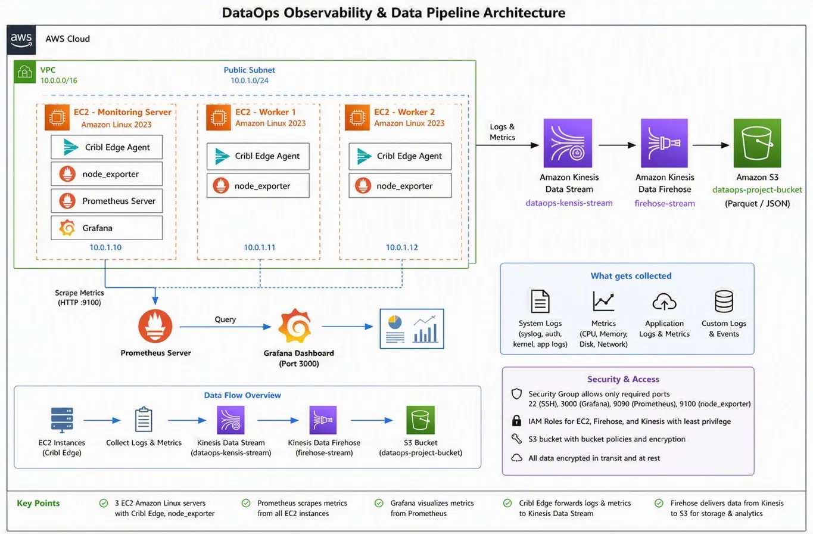

### Metrics pipeline

1. Node Exporter exposes Linux host metrics on each of the three EC2 instances.
2. Prometheus scrapes the three Node Exporter endpoints over the VPC network.
3. Grafana queries Prometheus to display host health and performance dashboards.

### Logs pipeline

1. Cribl Edge runs on the Linux instances and forwards logs to Amazon Kinesis Data Streams.
2. Amazon Data Firehose reads the stream and delivers log objects to Amazon S3 using time-based prefixes.
3. Amazon S3 provides durable storage for the delivered log files.

## Infrastructure

| Instance | Terraform instance type | Main components |
|---|---|---|
| Monitoring server (`10.0.1.10`) | `t3.medium` | Prometheus, Grafana, Node Exporter, Cribl Edge |
| Worker 1 (`10.0.1.11`) | `t3.small` | Node Exporter, Cribl Edge |
| Worker 2 (`10.0.1.12`) | `t3.small` | Node Exporter, Cribl Edge |

### AWS services and tools

- **Amazon EC2** — hosts the monitoring server and two worker instances.
- **Amazon VPC** — provides the network for the instances and internal metrics traffic.
- **Amazon Kinesis Data Streams** — receives forwarded log events.
- **Amazon Data Firehose** — delivers records from Kinesis Data Streams to S3.
- **Amazon S3** — stores delivered log objects.
- **AWS IAM** — grants the EC2 and Firehose components the permissions they need.
- **Terraform** — defines and manages the infrastructure as code.
- **Prometheus, Grafana, Node Exporter, and Cribl Edge** — provide metrics collection, visualization, and log forwarding.

## Metrics and dashboards

Node Exporter exposes host-level metrics, including CPU, memory, disk and filesystem usage, network activity, load average, and uptime. The configured Prometheus scrape targets are:

| Target | Address | Purpose |
|---|---|---|
| Monitoring server | `10.0.1.10:9100` | Monitoring host metrics |
| Worker 1 | `10.0.1.11:9100` | Worker 1 host metrics |
| Worker 2 | `10.0.1.12:9100` | Worker 2 host metrics |

The targets were observed as **UP** in Prometheus during project validation. From a host with network access to a target, Node Exporter metrics can be checked at `http://<instance-private-ip>:9100/metrics` (for example, locally with `curl http://localhost:9100/metrics`).

| Component | Port | Intended access |
|---|---:|---|
| Grafana | `3000` | Restricted to the configured administrator CIDR |
| Prometheus | `9090` | Restricted to the configured administrator CIDR |
| Node Exporter | `9100` | Internal VPC traffic only |
| SSH | `22` | Restricted to the configured administrator CIDR |

## Log delivery

The log pipeline is:

`Linux instances → Cribl Edge → Kinesis Data Streams → Amazon Data Firehose → Amazon S3`

Firehose writes log objects with time-based prefixes, making delivered data easier to browse by date and hour. The S3 destination is configured with server-side encryption, S3 Block Public Access, and a bucket-policy control that denies insecure transport for applicable requests.

## Terraform layout

The `terraform/` directory contains the infrastructure definitions, including:

- `network.tf` — VPC and network resources.
- `compute.tf` — EC2 instances.
- `security.tf` — security groups and access restrictions.
- `pipeline.tf` — streaming, Firehose, and S3 resources.
- `provider.tf` and `versions.tf` — provider and Terraform version configuration.
- `variables.tf` and `outputs.tf` — configurable inputs and useful outputs.
- `terraform.tfvars.example` — example input values; it is not the active local configuration.

Terraform state is configured to use an S3 backend with lock-file-based state locking. Keep the backend configuration and state protected; do not commit Terraform state files or real `terraform.tfvars` files.

### Run Terraform

Run these commands from the Terraform directory after configuring AWS credentials and reviewing the input variables for your own environment:

```bash
cd terraform
terraform init
terraform fmt -check
terraform validate
terraform plan
```

Review the plan carefully before applying changes:

```bash
terraform apply
```

The example `allowed_cidr` value is documentation-only. Replace it in your local, untracked `terraform.tfvars` with the public IP/CIDR that should be allowed to reach SSH, Grafana, and Prometheus. Do not commit that real configuration file.

### Cost and cleanup

These resources can incur AWS charges while running. Stop or remove lab resources when you no longer need them, and check the AWS console for resources left behind. Before destroying the infrastructure, retain any logs you need and empty the S3 destination bucket intentionally if you want Terraform to delete it: the bucket uses `force_destroy = false`, so a non-empty bucket can prevent deletion.

## Security choices

- Administrative access to SSH, Grafana, and Prometheus is restricted by the `allowed_cidr` variable.
- Node Exporter port `9100` is intended for internal VPC access rather than public exposure.
- S3 Block Public Access and server-side encryption are enabled.
- The S3 policy denies insecure transport for applicable requests.
- IAM permissions for the stream producer and Firehose delivery are scoped to the required resources and actions.
- Terraform state, plans, local variable files, environment files, and credential/key files are excluded from version control by `.gitignore`.

## Screenshots

The screenshots below document the infrastructure, metric collection, dashboards, and log delivery observed during testing. Instance addresses and resource names can change when the lab is recreated.

### Infrastructure

**EC2 instances**

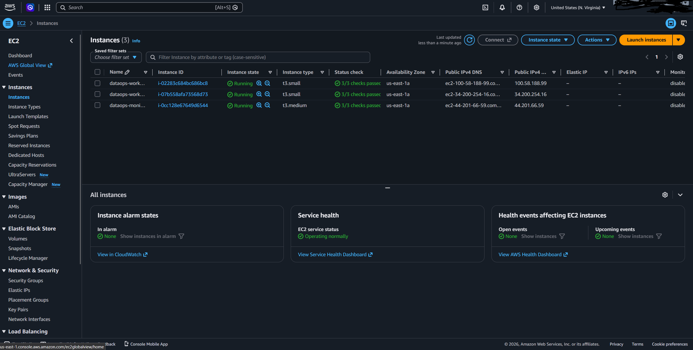

**IAM roles**

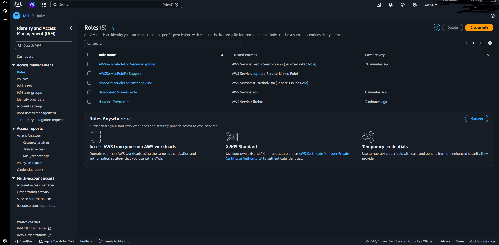

### Metrics and dashboards

**Prometheus dashboard**

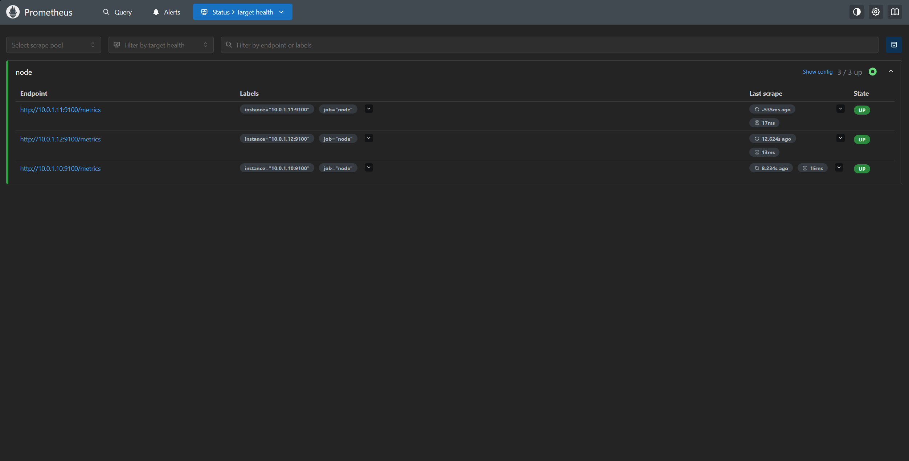

**Grafana overview (one-hour view)**

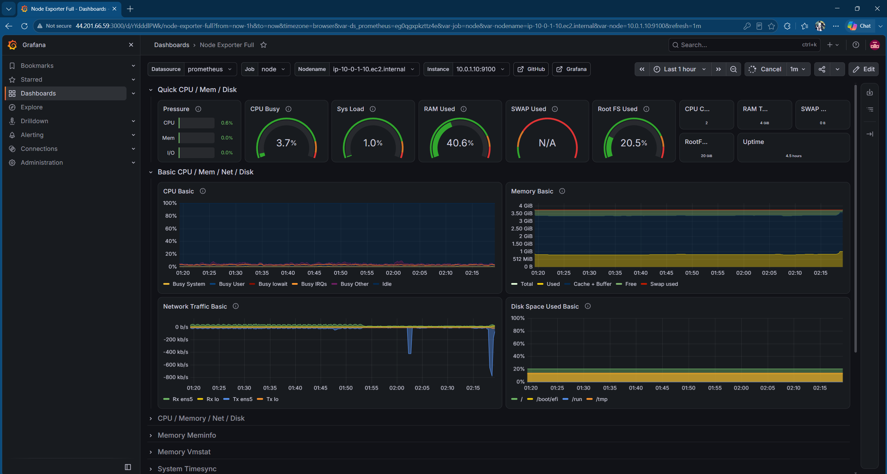

**Worker 1 dashboard (one-hour view)**

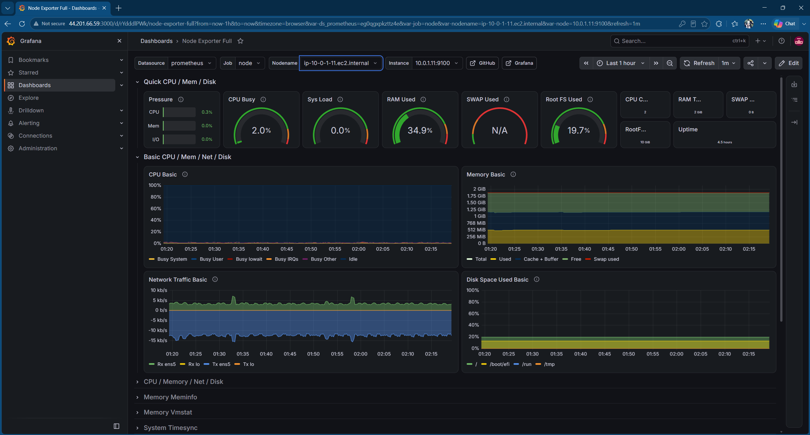

**Worker 2 dashboard (one-hour view)**


**CPU core count panel**

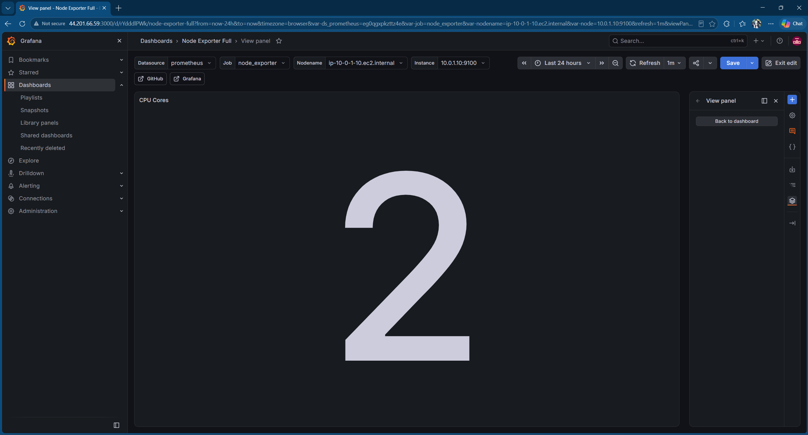

**Memory panel — 2 GiB instance**

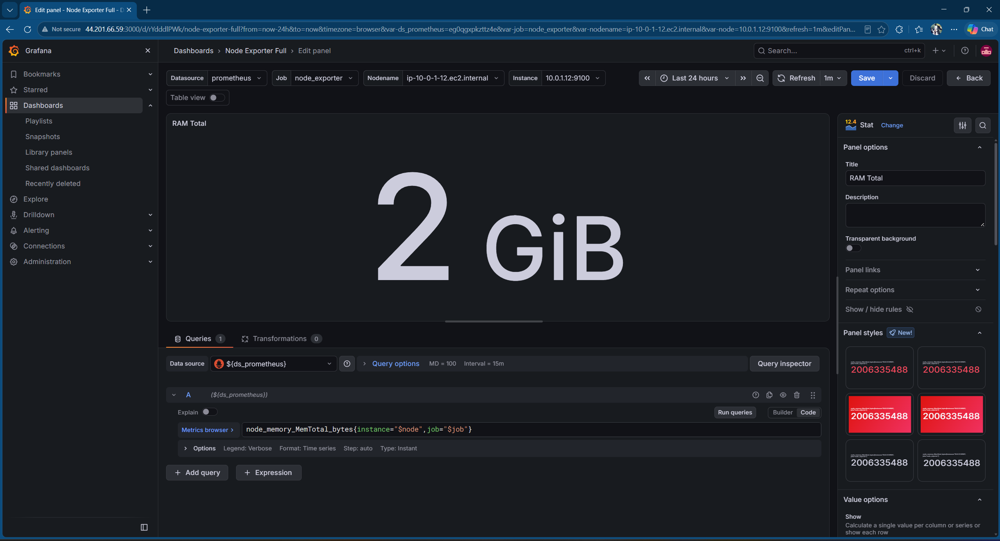

**Memory panel — 4 GiB instance**

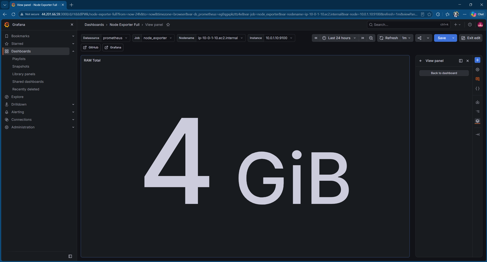

### Log pipeline and S3 delivery

**Kinesis Data Streams**

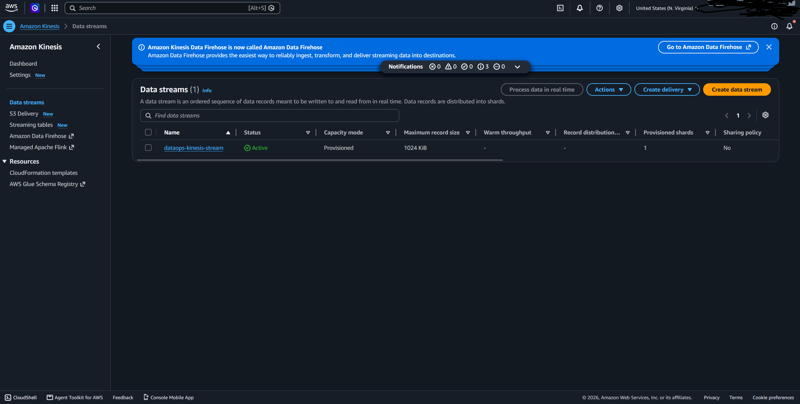

**Firehose delivery status and source time**

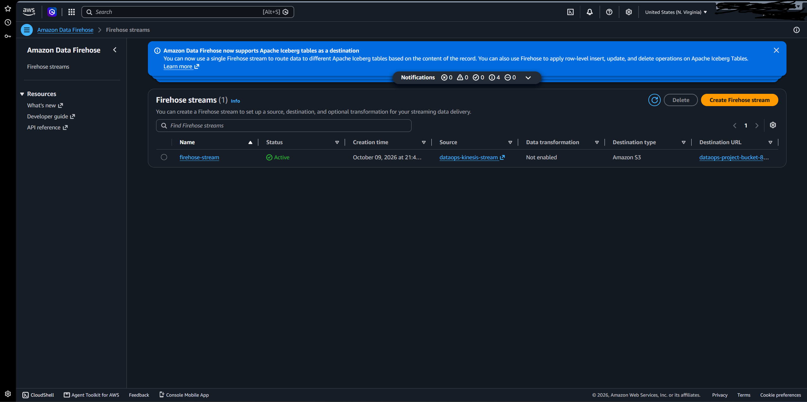

**Delivered objects in S3**

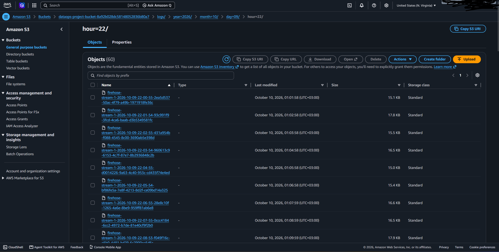

## Project status

This repository documents a hands-on observability lab built with Terraform and AWS-managed streaming services. The screenshots record the state observed during testing; they are evidence of the lab at that time, not a guarantee that the resources are still running.
