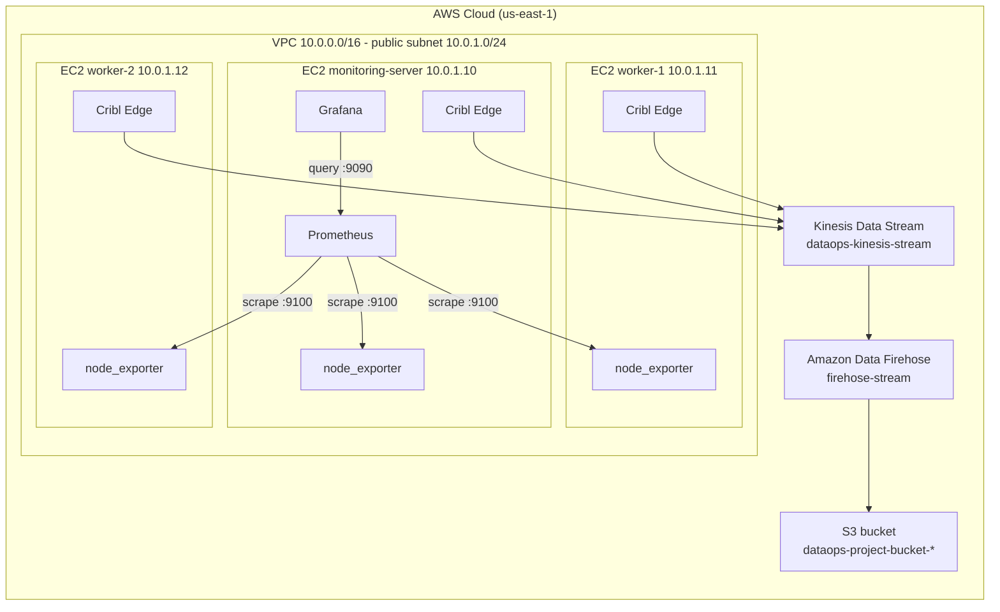

# DataOps Observability Platform on AWS

A small observability and log pipeline built on AWS and managed with Terraform. Three Linux servers are monitored with Prometheus and Grafana. Their logs are collected by Cribl Edge and delivered through Amazon Kinesis Data Streams and Amazon Data Firehose to Amazon S3.

Author: Kryptida

## Contents

1. [Overview](#1-overview)
2. [Architecture](#2-architecture)
3. [Repository structure](#3-repository-structure)
4. [Infrastructure created by Terraform](#4-infrastructure-created-by-terraform)
5. [Prerequisites](#5-prerequisites)
6. [Deployment](#6-deployment)
7. [Validation](#7-validation)
8. [Screenshots](#8-screenshots)
9. [Security](#9-security)
10. [Cost](#10-cost)
11. [Teardown](#11-teardown)
12. [Limitations and possible improvements](#12-limitations-and-possible-improvements)

## 1. Overview

The project has three goals:

- Collect CPU, memory, disk and network metrics from three servers and show them in Grafana.
- Collect system logs from the same servers and store them in Amazon S3.
- Create all AWS infrastructure from code, so that it can be built and removed with a few commands.

Terraform creates the AWS infrastructure only. The software that runs on the servers (Node Exporter, Prometheus, Grafana and Cribl Edge) is installed by hand, following [section 6](#6-deployment).

## 2. Architecture



### Metrics flow

1. Node Exporter runs on all three servers and exposes metrics on port 9100.
2. Prometheus on the monitoring server scrapes the three Node Exporter endpoints over their private IP addresses.
3. Grafana queries Prometheus on port 9090 and displays the "Node Exporter Full" dashboard (dashboard ID 1860).

### Logs flow

1. A Cribl Edge agent on each server reads the systemd journal and the files in `/var/log`.
2. Cribl Edge sends the events to the Kinesis data stream `dataops-kinesis-stream`.
3. Amazon Data Firehose (`firehose-stream`) reads from the stream and writes the data to S3 under time-based prefixes. The data is stored without format conversion (JSON, no Parquet).

### Components

| Component | Details |
| --- | --- |
| Network | VPC `10.0.0.0/16`, one public subnet `10.0.1.0/24` in `us-east-1a`, internet gateway, public route table |
| Monitoring server | Amazon Linux 2023, `t3.medium`, 20 GB encrypted gp3 volume, private IP `10.0.1.10` |
| Worker servers | Amazon Linux 2023, `t3.small`, 10 GB encrypted gp3 volume each, private IPs `10.0.1.11` and `10.0.1.12` |
| Metrics | Node Exporter, Prometheus, Grafana |
| Log collection | Cribl Edge (managed from Cribl.Cloud, fleet `default_fleet`) |
| Streaming | Kinesis Data Stream, provisioned mode, 1 shard, 24 hour retention, server-side encryption |
| Delivery | Amazon Data Firehose, Kinesis source, S3 destination, buffer 1 MB or 60 seconds |
| Storage | S3 bucket with the prefix `dataops-project-bucket-`, encrypted, public access blocked |

## 3. Repository structure

```text
.
├── README.md
├── .gitignore
├── monitoring/                      Screenshots used in this document
└── terraform/
    ├── versions.tf                  Terraform and provider versions, S3 backend
    ├── provider.tf                  AWS provider and default tags
    ├── variables.tf                 Region, CIDR blocks, instance types, SSH key path
    ├── network.tf                   VPC, internet gateway, subnet, route table
    ├── security.tf                  Security group and the allowed_cidr variable
    ├── compute.tf                   AMI lookup, key pair, three EC2 instances
    ├── pipeline.tf                  S3 bucket, Kinesis, Firehose, IAM roles and policies
    ├── outputs.tf                   Public and private IPs, Grafana and Prometheus URLs
    ├── terraform.tfvars.example     Example input file
    └── .terraform.lock.hcl          Provider version lock
```

## 4. Infrastructure created by Terraform

| File | Resources |
| --- | --- |
| `network.tf` | VPC, internet gateway, public subnet, route table and association |
| `security.tf` | Security group `dataops-servers-sg` |
| `compute.tf` | Key pair `dataops-key`, three EC2 instances (monitoring, worker-1, worker-2) with fixed private IPs |
| `pipeline.tf` | S3 log bucket (public access block, encryption, bucket policy), Kinesis stream, Firehose delivery stream, Firehose IAM role and policy, EC2 IAM role, policy and instance profile |

Every resource is tagged with `Project = dataops` and `ManagedBy = terraform`.

## 5. Prerequisites

- An AWS account and an IAM user with an access key that Terraform can use. This project uses an AWS CLI profile named `dataops` in `us-east-1`.
- Terraform 1.10 or later (the S3 backend uses `use_lockfile`).
- AWS CLI v2.
- Git, `curl` and an SSH client.
- A free Cribl.Cloud account for the Cribl Edge leader.

## 6. Deployment

All commands are run from a Linux shell.

### 6.1 Clone the repository

```bash
git clone https://github.com/Kryptida/dataops-observability-platform.git
cd dataops-observability-platform/terraform
```

### 6.2 Configure the AWS profile

```bash
aws configure --profile dataops
export AWS_PROFILE=dataops
aws sts get-caller-identity
```

The last command must return your account and the IAM user. Set `AWS_PROFILE` again in every new terminal.

### 6.3 Create the Terraform state bucket

Terraform stores its state in an S3 bucket that must exist before `terraform init`. Bucket names are unique worldwide, so a random suffix is added.

```bash
STATE_BUCKET="dataops-tfstate-$(openssl rand -hex 4)"
aws s3api create-bucket --bucket "$STATE_BUCKET" --region us-east-1
aws s3api put-public-access-block --bucket "$STATE_BUCKET" \
  --public-access-block-configuration BlockPublicAcls=true,IgnorePublicAcls=true,BlockPublicPolicy=true,RestrictPublicBuckets=true
echo "$STATE_BUCKET" > ~/.dataops-state-bucket
```

The bucket name is saved outside the repository.

### 6.4 Create the SSH key

```bash
ssh-keygen -t ed25519 -f ~/.ssh/dataops-key -N ""
```

Terraform uploads only the public key (`~/.ssh/dataops-key.pub`). The private key never leaves your machine and is excluded by `.gitignore`.

### 6.5 Set the allowed IP address

SSH (22), Grafana (3000) and Prometheus (9090) are reachable only from the address in `allowed_cidr`. Set it to your current public IP:

```bash
echo "allowed_cidr = \"$(curl -s https://checkip.amazonaws.com)/32\"" > terraform.tfvars
cat terraform.tfvars
```

`terraform.tfvars` is excluded by `.gitignore`. If your public IP changes later, update the file and run `terraform apply` again.

### 6.6 Create the infrastructure

```bash
terraform init -backend-config="bucket=$(cat ~/.dataops-state-bucket)"
terraform validate
terraform plan -out=tfplan
terraform apply tfplan
```

Review the plan before applying. When the apply finishes, list the addresses:

```bash
terraform output
```

Wait a minute or two for the servers to boot, then connect:

```bash
ssh -i ~/.ssh/dataops-key ec2-user@<public-ip>
```

The user is `ec2-user`. The three servers use the private IPs `10.0.1.10`, `10.0.1.11` and `10.0.1.12`.

### 6.7 Install Node Exporter (all three servers)

Run on each server:

```bash
NE_VERSION=$(curl -s https://api.github.com/repos/prometheus/node_exporter/releases/latest | grep -m1 '"tag_name"' | sed -E 's/.*"v([^"]+)".*/\1/')
echo "$NE_VERSION"
cd /tmp
curl -fsSLO "https://github.com/prometheus/node_exporter/releases/download/v${NE_VERSION}/node_exporter-${NE_VERSION}.linux-amd64.tar.gz"
tar xzf "node_exporter-${NE_VERSION}.linux-amd64.tar.gz"
sudo install -m 0755 "node_exporter-${NE_VERSION}.linux-amd64/node_exporter" /usr/local/bin/node_exporter
sudo useradd --system --no-create-home --shell /sbin/nologin node_exporter

sudo tee /etc/systemd/system/node_exporter.service > /dev/null <<'EOF'
[Unit]
Description=Prometheus Node Exporter
After=network-online.target
Wants=network-online.target

[Service]
User=node_exporter
ExecStart=/usr/local/bin/node_exporter
Restart=on-failure

[Install]
WantedBy=multi-user.target
EOF

sudo systemctl daemon-reload
sudo systemctl enable --now node_exporter
curl -s localhost:9100/metrics | head -3
```

The last command must print metric lines.

### 6.8 Install Prometheus (monitoring server only)

```bash
PROM_VERSION=$(curl -s https://api.github.com/repos/prometheus/prometheus/releases/latest | grep -m1 '"tag_name"' | sed -E 's/.*"v([^"]+)".*/\1/')
echo "$PROM_VERSION"
cd /tmp
curl -fsSLO "https://github.com/prometheus/prometheus/releases/download/v${PROM_VERSION}/prometheus-${PROM_VERSION}.linux-amd64.tar.gz"
tar xzf "prometheus-${PROM_VERSION}.linux-amd64.tar.gz"
sudo useradd --system --no-create-home --shell /sbin/nologin prometheus
sudo mkdir -p /etc/prometheus /var/lib/prometheus
sudo install -m 0755 "prometheus-${PROM_VERSION}.linux-amd64/prometheus" "prometheus-${PROM_VERSION}.linux-amd64/promtool" /usr/local/bin/

sudo tee /etc/prometheus/prometheus.yml > /dev/null <<'EOF'
global:
  scrape_interval: 15s

scrape_configs:
  - job_name: "node"
    static_configs:
      - targets:
          - "10.0.1.10:9100"
          - "10.0.1.11:9100"
          - "10.0.1.12:9100"
EOF

sudo chown -R prometheus:prometheus /etc/prometheus /var/lib/prometheus

sudo tee /etc/systemd/system/prometheus.service > /dev/null <<'EOF'
[Unit]
Description=Prometheus
After=network-online.target
Wants=network-online.target

[Service]
User=prometheus
ExecStart=/usr/local/bin/prometheus --config.file=/etc/prometheus/prometheus.yml --storage.tsdb.path=/var/lib/prometheus
Restart=on-failure

[Install]
WantedBy=multi-user.target
EOF

sudo systemctl daemon-reload
sudo systemctl enable --now prometheus
curl -s localhost:9090/-/ready
```

Open `http://<monitoring-public-ip>:9090/targets`. All three targets must show `UP`.

### 6.9 Install Grafana (monitoring server only)

```bash
sudo tee /etc/yum.repos.d/grafana.repo > /dev/null <<'EOF'
[grafana]
name=grafana
baseurl=https://rpm.grafana.com
repo_gpgcheck=1
enabled=1
gpgcheck=1
gpgkey=https://rpm.grafana.com/gpg.key
sslverify=1
sslcacert=/etc/pki/tls/certs/ca-bundle.crt
EOF

sudo dnf install -y grafana
sudo systemctl enable --now grafana-server
```

Then, in the browser:

1. Open `http://<monitoring-public-ip>:3000`. The default login is `admin` / `admin`. Change the password when prompted.
2. Go to Connections, Data sources, Add data source, choose Prometheus, set the URL to `http://localhost:9090` and click Save and test.
3. Go to Dashboards, New, Import, enter the ID `1860` and choose the Prometheus data source.
4. Use the Instance selector at the top of the dashboard to switch between the three servers.

### 6.10 Install Cribl Edge (all three servers)

1. Sign in to Cribl.Cloud and open Cribl Edge.
2. Open the fleet `default_fleet`, choose Add/Update Edge Node, select Linux and copy the install command.
3. Run the command on each server with `sudo`. The command contains a token for your own Cribl.Cloud organization. Do not commit it or share it.
4. In the fleet, open Nodes and confirm that all three servers show as connected.
5. Open Collect and enable these sources: Journal Files (`in_journal_local`) and File Monitor (`in_file_varlog`). Amazon Linux 2023 uses journald, so the journal source is the main log source.
6. Add a Kinesis destination (`kinesis_out`) with the stream name `dataops-kinesis-stream`, the region `us-east-1` and the authentication method Auto. The instances use the IAM role that Terraform attaches to them, which allows writing to this stream.
7. Connect the sources to `kinesis_out` and choose Commit and Deploy.

## 7. Validation

### Metrics

```bash
# On any server
curl -s localhost:9100/metrics | head -3

# On the monitoring server
curl -s localhost:9090/api/v1/targets | grep -o '"health":"[a-z]*"'
```

Expected: metric lines from Node Exporter, and three `"health":"up"` results from Prometheus. In Grafana, dashboard 1860 must show live data for each of the three instances.

### Logs

On any server, write a test message:

```bash
logger "DataOps Pipeline Test"
```

Firehose buffers data for up to 60 seconds, so wait two minutes, then list the bucket from your workstation:

```bash
LOG_BUCKET=$(aws s3 ls | awk '/dataops-project-bucket-/{print $3}')
aws s3 ls "s3://$LOG_BUCKET/logs/" --recursive | tail
```

Expected: objects under `logs/year=YYYY/month=MM/day=DD/hour=HH/`. If nothing appears, check these in order:

1. Cribl: the nodes are connected and the configuration is deployed.
2. Kinesis: the stream shows incoming records in its monitoring tab.
3. Firehose: the delivery stream status is Active and shows no delivery errors.
4. S3: look under the `errors/` prefix as well.

## 8. Screenshots

All screenshots are in the [`monitoring`](monitoring) folder and were taken from the running deployment.

### AWS infrastructure

EC2 instances (three servers running):


Security group for the servers:


IAM roles:


### Metrics: Prometheus


### Metrics: Grafana, monitoring server


Last hour and last 24 hours:


Uptime, CPU cores and memory:


### Metrics: Grafana, worker servers

Worker 1:


Worker 2:


### Log pipeline

Cribl Edge nodes:


Kinesis data stream:


Firehose delivery stream:


S3 bucket with delivered logs:


## 9. Security

| Area | Configuration |
| --- | --- |
| Network access | SSH (22), Grafana (3000) and Prometheus (9090) accept traffic only from the single address in `allowed_cidr`. Node Exporter (9100) accepts traffic only from inside the VPC. |
| EC2 permissions | The instance role allows only `kinesis:ListShards`, `kinesis:PutRecord` and `kinesis:PutRecords`, and only on the project stream. |
| Firehose permissions | The Firehose role can read from the project stream and write to the project bucket only. |
| S3 | Public access is blocked, objects are encrypted with SSE-S3 (AES256), and a bucket policy denies requests that do not use TLS. |
| Kinesis | Server-side encryption with the AWS managed key `alias/aws/kinesis`. |
| EC2 volumes | Root volumes are encrypted. |
| Terraform state | Stored in a private, encrypted S3 bucket with state locking. |
| Secrets | `.gitignore` excludes state files, private keys, `*.pem`, credentials and `terraform.tfvars`. No credentials are stored in this repository. |

## 10. Cost

The stack runs on on-demand pricing. As a rough guide, the whole project costs about 10 to 12 US cents per hour in `us-east-1`, mostly from the three EC2 instances, a Kinesis shard, public IPv4 addresses and EBS storage. Prices change, so check the current AWS pricing pages before deploying.

The infrastructure is meant to be short-lived. Destroy it when you finish, as described below. Stopped instances still incur storage charges, so destroying is cheaper than stopping.

## 11. Teardown

Remove everything created by Terraform:

```bash
cd terraform
export AWS_PROFILE=dataops
terraform destroy
```

Type `yes` when prompted. The log bucket has `force_destroy` enabled, so it is deleted even when it contains logs.

Verify that nothing is left:

```bash
terraform state list
aws ec2 describe-instances --region us-east-1 --filters "Name=instance-state-name,Values=pending,running,stopping,stopped" --query 'Reservations[].Instances[].InstanceId' --output text
aws ec2 describe-volumes --region us-east-1 --query 'Volumes[].VolumeId' --output text
aws ec2 describe-addresses --region us-east-1 --query 'Addresses[].PublicIp' --output text
aws kinesis list-streams --region us-east-1
aws firehose list-delivery-streams --region us-east-1
aws s3 ls
aws ec2 describe-vpcs --region us-east-1 --query 'Vpcs[].[VpcId,CidrBlock]' --output text
```

Expected: an empty state list, no instances, no project volumes, no Elastic IPs, empty Kinesis and Firehose lists, and no `dataops-project-bucket-` bucket. Only the default VPC remains.

Then remove the items that Terraform does not manage:

```bash
aws s3 rb "s3://$(cat ~/.dataops-state-bucket)" --force
```

- Delete the access key and the IAM user that you created for Terraform.
- Remove the `dataops` profile from `~/.aws/credentials` and `~/.aws/config`.
- In Cribl.Cloud, remove the disconnected Edge Nodes.
- Check the AWS Billing console the next day.

## 12. Limitations and possible improvements

Limitations:

- Software on the servers is installed by hand. Terraform provisions only the AWS resources.
- Grafana and Prometheus are served over plain HTTP and are protected only by the IP allow list.
- Everything runs in one availability zone, with one Kinesis shard and no autoscaling.
- Data is stored as delivered, with no format conversion. Parquet is not used.
- The Cribl leader runs in Cribl.Cloud, outside AWS.

Possible improvements:

- Install the server software automatically with EC2 user data or a configuration management tool.
- Put Grafana behind HTTPS with a load balancer or reverse proxy.
- Add Grafana alerting and Prometheus Alertmanager.
- Query the stored logs with Athena.
- Add a CI workflow that runs `terraform fmt` and `terraform validate` on every push.
